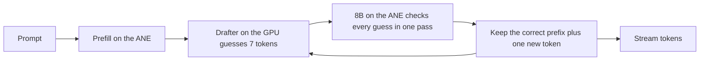

# Anemone

Anemone runs open-weight LLMs on the Apple Neural Engine (ANE). The large model runs on the ANE, a small drafter on the GPU guesses the next few tokens, and the ANE checks all the guesses in one pass. The output is exactly what the model produces when it decodes one token at a time.

Status: design and lab prototype. The Swift engine is not built yet, so there is nothing to install. Every number below comes from the Python lab prototype on one Mac.

## Results so far

Qwen3-8B with thinking off, greedy decoding, 6 prompts x 256 tokens. M3 Pro 18 GB, macOS 27.0.1, AC power, quiet machine.

| engine | where the 8B runs | tokens/s | wall power | energy per token |
|---|---|---|---|---|
| **Anemone prototype: 8B on the ANE, DSpark drafter on the GPU** | **ANE** | **41.0** | **19.8 W** | **0.53 J** |
| MLX 4-bit + DSpark drafter | GPU | 32.2 | 39.2 W | 1.28 J |
| MLX 4-bit | GPU | 30.8 | 30.9 W | 1.10 J |
| 8B on the ANE, no drafter | ANE | 15.1 | 14.1 W | 0.95 J |

- 1.33x faster than plain MLX and 2.1x less energy per token, at 64% of the wall power.
- Tokens/s is decode only. Power and energy are whole-system readings from the SMC over two interleaved rounds; see [Benchmarks](docs/benchmarks.md).

Quality of the 4-bit weights, measured against the bf16 model on the same text (lower KL is closer; top-1 is how often the most likely next token matches):

| 4-bit weights | KL, docs | KL, chat | top-1, docs | top-1, chat |
|---|---|---|---|---|
| **Anemone palettizer, on the ANE** | **0.047** | **0.086** | **0.892** | **0.919** |
| MLX 4-bit affine, group 64, on the GPU | 0.085 | 0.086 | 0.870 | 0.902 |
| Core AI default palettizer, on the ANE | 0.341 | 0.371 | 0.767 | 0.825 |

Same file size and same speed as the Core AI default, with 7.3x lower KL on docs and 4.3x on chat.

## How it works

- Decoding one token at a time is limited by how fast weights stream from memory. The ANE streams them at about half the GPU's speed, so on its own it loses: 15.1 vs 30.8 tokens/s.
- The ANE has spare compute. Checking 16 tokens in one call costs 67.5 ms; producing one token costs 65.8 ms.
- The DSpark drafter (from DeepSeek) is small and runs on the GPU. When 2.74 of its guesses are accepted on average, each 88.6 ms cycle yields 3.74 tokens.
- A guess is kept only if it equals the 8B's own top choice, so the text is identical to plain greedy decoding.

Details: [Architecture](docs/architecture.md) and [Math](docs/math.md).

## What is new

- GPTQ error feedback onto the ANE's lookup-table weights. Core AI stores 4-bit weights as 16 values per group of 32 rows. Anemone picks those 16 values with activation-weighted k-means, then snaps one input column at a time and pushes each column's rounding error onto the columns not yet snapped. The result still has 16 values per group, so it exports through Core AI unchanged.
- Calibration on the model's own chat answers. Adding 4.3k tokens of the model's replies to 16 unrelated prompts lowered chat KL from 0.139 to 0.086.
- A palettization simulator that predicts on-device quality within 0.004 KL, so weights can be tuned without an export.
- A closer target accepts more drafts: math went from 3.98 to 5.07 accepted tokens per check.

## Requirements

- Apple Silicon Mac with macOS 27 and Xcode 27 (Core AI). Tested on M3 Pro only.
- The first load of a model on a new Mac takes about 7 minutes while macOS compiles it for the ANE. Later loads are instant.

## Roadmap

1. Pick the drafter runtime by measurement: MLX Swift, or a Core AI GPU program chained to the ANE without a CPU sync.
2. Engine core: the `Anemone` Swift package for apps and the `anemone` command line tool, built together.
3. Usable: `anemone chat`, `anemone serve` with an OpenAI-compatible API, model download from Hugging Face, context up to 4096 tokens.
4. Faster: token trees, confidence-scheduled drafting, a smaller draft vocabulary. Target 45 to 49 tokens/s.
5. 8192-token context. Today a chunk costs 3.1x more at 8192 than at 1024, for a reason not yet found.
6. More models: DeepSeek-R1-0528-Qwen3-8B, other Qwen3 sizes, then other families with DSpark-style drafters.

## Docs

- [Architecture](docs/architecture.md): parts, decode loop, model pipeline.
- [Math](docs/math.md): the formulas behind speed, energy and quality, with worked examples.
- [Benchmarks](docs/benchmarks.md): every measurement, with setup and method.
- [Contributing](CONTRIBUTING.md).

## Credits

- DeepSeek's DeepInfer for the DSpark drafter and confidence-scheduled verification.
- Apple's Core AI for the ANE runtime.
- Qwen3 by the Qwen team. Model weights keep their own licenses.

## License

MIT. See [LICENSE](LICENSE).
