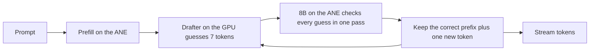

# Anemone

Fast, low-power LLM inference on the Apple Neural Engine (ANE).

Anemone runs the large model on the ANE and a small drafter on the GPU. The drafter guesses the next 7 tokens, and the ANE checks all of them in one pass. Qwen3-8B generates **45.5 tokens/s on an M3 Pro, 1.5x MLX on the GPU, at 0.48 J per token, 2.4x less energy**. The output is token for token what the model produces on its own.

```text
$ anemone bench --model models/qwen3-8b
math      plain  16.2 tok/s   speculative  77.3 tok/s   accepted 5.50   lossless yes
code      plain  16.3 tok/s   speculative  66.9 tok/s   accepted 4.54   lossless yes
explain   plain  16.3 tok/s   speculative  42.7 tok/s   accepted 2.62   lossless yes
summary   plain  16.3 tok/s   speculative  32.5 tok/s   accepted 1.75   lossless yes
advice    plain  16.3 tok/s   speculative  35.2 tok/s   accepted 1.93   lossless yes
translate plain  16.3 tok/s   speculative  18.6 tok/s   accepted 0.65   lossless yes
mean      plain  16.3 tok/s   speculative  45.5 tok/s   accepted 2.83   lossless 6/6
```

## Results

Qwen3-8B, thinking off, greedy decoding, 6 prompts x 256 tokens. M3 Pro 18 GB, macOS 27.0.1, AC power.

| engine | where the 8B runs | tokens/s | wall power | energy per token |
|---|---|---|---|---|
| **Anemone (Swift): 8B on the ANE, drafter on the GPU** | **ANE** | **45.5** | **19.5 W** | **0.48 J** |
| MLX 4-bit + DSpark drafter | GPU | 32.2 | 40.3 W | 1.31 J |
| MLX 4-bit | GPU | 30.8 | 31.7 W | 1.14 J |
| Anemone without the drafter | ANE | 16.3 | 15.4 W | 0.96 J |

- 1.48x faster than MLX and 2.4x less energy per token, at 62% of the wall power. The GPU draws about 1 W; the drafter is small.
- Tokens/s is decode speed (`anemone bench`; MLX from the lab night run on the same Mac and macOS). Power and energy are whole-system SMC readings over the generation window including prefill, two rounds each, all measured the same night. See [Benchmarks](docs/benchmarks.md) for every run and its method.

The 4-bit weights are also closer to the original model than MLX 4-bit (KL against bf16, lower is better):

| 4-bit weights | KL, docs | KL, chat | top-1, docs | top-1, chat |
|---|---|---|---|---|
| **Anemone (GPTQ onto ANE lookup tables)** | **0.047** | **0.086** | **0.892** | **0.919** |
| MLX 4-bit affine, group 64 | 0.085 | 0.086 | 0.870 | 0.902 |
| Core AI default palettizer | 0.341 | 0.371 | 0.767 | 0.825 |

## Quick start

Requirements: an Apple Silicon Mac with macOS 27 and Xcode 27. Tested on M3 Pro (18 GB).

```sh
git clone https://github.com/vakharwalad23/Anemone.git
cd Anemone
swift build -c release
```

Make a model folder with the converter (see [Converting a model](docs/convert.md)); prebuilt folders on Hugging Face are coming. Then:

```sh
.build/release/anemone run --model models/qwen3-8b "Explain how a CPU cache works."
.build/release/anemone chat --model models/qwen3-8b
.build/release/anemone bench --model models/qwen3-8b
```

Or serve an OpenAI-compatible API and point any OpenAI client at `http://127.0.0.1:8080/v1`:

```sh
.build/release/anemone serve --model models/qwen3-8b --port 8080
curl http://127.0.0.1:8080/v1/chat/completions -H "Content-Type: application/json" \
  -d '{"messages": [{"role": "user", "content": "Write a haiku about the sea."}], "stream": true}'
```

The first load on a Mac compiles the model for the ANE and takes about 7.5 minutes. macOS caches the result per app, so later loads take about 4 seconds.

## Use it from Swift

```swift
// Package.swift
.package(url: "https://github.com/vakharwalad23/Anemone.git", branch: "main")
```

```swift
import Anemone

let model = try await LanguageModel.load(from: URL(fileURLWithPath: "models/qwen3-8b"))
for try await event in model.generate([ChatMessage(.user, "Write a haiku about the sea.")]) {
    switch event {
    case .text(let piece): print(piece, terminator: "")
    case .finished(let response): print("\n\(response.stats.tokensPerSecond) tok/s")
    }
}
```

## How it works



- Decoding one token at a time is limited by how fast the weights stream from memory, and the ANE streams them at about half the GPU's speed. On its own the ANE loses: 16.3 tokens/s against 30.8 for MLX.
- The ANE has spare compute, so checking 16 tokens costs about the same as producing one: 62 ms per check against 61 ms per plain token.
- The DSpark drafter from DeepSeek is small and runs on the GPU in 20.5 ms. A cycle of draft plus check takes 83 ms and yields 3.83 tokens on average.
- A guess is kept only if it equals the 8B's own top choice, so the text is identical to plain greedy decoding. `anemone bench` checks this on every run.

Details: [Architecture](docs/architecture.md) and [Math](docs/math.md).

## What is new

- GPTQ onto the ANE lookup tables. Core AI stores 4-bit weights as 16 values per group of 32 rows. Anemone picks the 16 values with activation-weighted k-means, then snaps one input column at a time and pushes each column's rounding error onto the columns not yet snapped. The result still has 16 values per group, so it exports through Core AI unchanged: same size and speed as Apple's default, 7.3x lower KL.
- Calibration on the model's own chat answers. Adding the model's replies to 16 unrelated prompts lowered chat KL from 0.139 to 0.086.
- The drafter as one Core AI GPU program. It adds the 8B's hidden states to its context, drafts 7 tokens and emits the embedded input for the next ANE check in one call, with fixed shapes so nothing recompiles.
- One KV cache for every context size. Each call uses the smallest context the conversation fits in, which is faster at short context.

## Converting a model

```sh
uv run --project convert --extra export anemone-convert quantize --out work/qwen3-8b-lut4
uv run --project convert --extra export anemone-convert target --checkpoint work/qwen3-8b-lut4 --out work/qwen3-8b-chunks
uv run --project convert --extra export anemone-convert drafter --out work/drafter.aimodel
uv run --project convert anemone-convert package --chunks work/qwen3-8b-chunks --drafter work/drafter.aimodel --out models/qwen3-8b
```

See [Converting a model](docs/convert.md) for what each step does, how long it takes and how much memory it needs.

## Status and roadmap

Working today: Qwen3-8B with thinking off, greedy decoding, up to 1024 tokens of context (4096 with the 4k export), one request at a time, `run`, `chat`, `serve` (OpenAI-compatible, streaming) and `bench`.

1. Done: drafter runtime picked by measurement, Swift engine and CLI, converter.
2. Next: prebuilt models on Hugging Face, 4096-token context by default.
3. Faster: hide the draft behind the ANE check, token trees with confidence scheduling, mixed 3/4/6-bit weights.
4. 8192-token context. Today a chunk costs 3.1x more at 8192 than at 1024, for a reason not yet found.
5. More models: DeepSeek-R1-0528-Qwen3-8B, other Qwen3 sizes, then other families with DSpark-style drafters.

## Docs

- [Architecture](docs/architecture.md): parts, decode loop, model pipeline.
- [Math](docs/math.md): the formulas behind speed, energy and quality, with worked examples.
- [Benchmarks](docs/benchmarks.md): every measurement, with setup and method.
- [Converting a model](docs/convert.md).
- [Contributing](CONTRIBUTING.md): measurements from other Macs are the most useful contribution.

## Credits

- DeepSeek's DeepInfer for the DSpark drafter and confidence-scheduled verification.
- Apple's Core AI and coreai-models for the ANE runtime and export tools.
- Qwen3 by the Qwen team. Model weights keep their own licenses.

## License

MIT. See [LICENSE](LICENSE).
