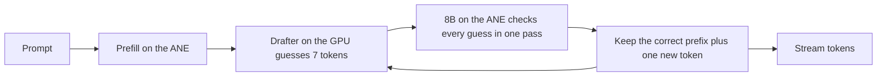

# Anemone

Fast, low-power LLM inference on the Apple Neural Engine (ANE).

Anemone runs the large model on the ANE and a small drafter on the GPU. The drafter guesses the next 7 tokens, and the ANE checks all of them in one pass. Qwen3-8B generates **45.5 tokens/s on an M3 Pro, 1.5x MLX on the GPU, at 0.48 J per token, 2.4x less energy**. The output is token for token what the model produces on its own.

```text
$ anemone bench --model models/qwen3-8b
math      plain  16.2 tok/s   speculative  77.3 tok/s   accepted 5.50   lossless yes
code      plain  16.3 tok/s   speculative  66.9 tok/s   accepted 4.54   lossless yes
explain   plain  16.3 tok/s   speculative  42.7 tok/s   accepted 2.62   lossless yes
summary   plain  16.3 tok/s   speculative  32.5 tok/s   accepted 1.75   lossless yes
advice    plain  16.3 tok/s   speculative  35.2 tok/s   accepted 1.93   lossless yes
translate plain  16.3 tok/s   speculative  18.6 tok/s   accepted 0.65   lossless yes
mean      plain  16.3 tok/s   speculative  45.5 tok/s   accepted 2.83   lossless 6/6
```

## Results

Qwen3-8B, thinking off, greedy decoding, 6 prompts x 256 tokens. M3 Pro 18 GB, macOS 27.0.1, AC power.

| engine | where the 8B runs | tokens/s | wall power | energy per token |
|---|---|---|---|---|
| **Anemone (Swift): 8B on the ANE, drafter on the GPU** | **ANE** | **45.5** | **19.5 W** | **0.48 J** |
| MLX 4-bit + DSpark drafter | GPU | 32.2 | 40.3 W | 1.31 J |
| MLX 4-bit | GPU | 30.8 | 31.7 W | 1.14 J |
| Anemone without the drafter | ANE | 16.3 | 15.4 W | 0.96 J |

- 1.48x faster than MLX and 2.4x less energy per token, at 62% of the wall power. The GPU draws about 1 W; the drafter is small.
- Tokens/s is decode speed (`anemone bench`; MLX from the lab night run on the same Mac and macOS). Power and energy are whole-system SMC readings over the generation window including prefill, two rounds each, all measured the same night. See [Benchmarks](docs/benchmarks.md) for every run and its method.

The 4-bit weights are also closer to the original model than MLX 4-bit (KL against bf16, lower is better):

| 4-bit weights | KL, docs | KL, chat | top-1, docs | top-1, chat |
|---|---|---|---|---|
| **Anemone (GPTQ onto ANE lookup tables)** | **0.047** | **0.086** | **0.892** | **0.919** |
| MLX 4-bit affine, group 64 | 0.085 | 0.086 | 0.870 | 0.902 |
| Core AI default palettizer | 0.341 | 0.371 | 0.767 | 0.825 |

The docs set (four files from one code repo) shares a domain with the text these weights were calibrated on, so its 0.047 is optimistic. With the converter's default calibration (Python standard library plus the model's own chat answers) the same method scores 0.107 on docs and 0.080 on chat: better than MLX on chat, worse on code and docs. Choosing calibration text is an open experiment.

## How it compares

Other public work on LLMs and the Neural Engine, as each project reports it (October 2026). The chips and models differ, so read each row against its own baseline, not against the other rows.

| project | model, chip | where it runs | result against its GPU baseline |
|---|---|---|---|
| **Anemone** | **Qwen3-8B 4-bit, M3 Pro** | **8B on the ANE, DSpark drafter on the GPU** | **45.5 vs 32.2 tok/s for MLX 4-bit + the same drafter (1.41x), 2.7x less energy per token, output checked equal to plain greedy on every run** |
| [MacPaw research](https://research.macpaw.com/projects/neural-engine) | LFM2.5-2.6B 8-bit, M4 Pro | model on the ANE with a DSpark drafter, trees up to 64 tokens | 136.9 vs 144.9 tok/s for MLX 8-bit + DSpark (0.94x), 2.6x to 3.4x less energy per request; no code published |
| [ANEMLL Forge](https://github.com/Anemll/anemll-forge) | Qwen3.8-27B 3-bit, M6 (M5 or newer only) | model and DFlash2 drafter on the ANE | 60.8 vs 54.2 tok/s for llama.cpp 3-bit at 8K context (1.12x), 41% to 47% less energy per token, up to 192K context |
| [mlx-ane-sd](https://github.com/allbilly/mlx-ane-sd) | Qwen3-4B 6-bit, M4 Pro | model and DFlash drafter on the ANE | 64.8 vs 29.3 tok/s for MLX bf16 (2.21x); token-identical only in a 1.80x setup |
| [ANEMLL](https://github.com/Anemll/Anemll) | Qwen3-8B, M3 | model on the ANE, no drafter | 2.97 tok/s after the 1 MiB DMA fix ([audit](https://runaihome.com/blog/apple-neural-engine-llm-inference-2026/)) |

What is different about Anemone:

- **An 8B model on the ANE beats the GPU at the same bit width with the same drafter on both sides.** We know of no other public result like it: MacPaw's ANE engine is about 5% behind MLX + DSpark, and the other speedups are against a bf16 baseline or a 27B model on M5 and newer.
- **It runs on an M3 Pro with 18 GB.** The other drafter results in the table need an M4 Pro, or an M5 or newer.
- **Each engine does what it is good at.** The 8B runs on the ANE, which has spare compute to check 16 guesses at once. The drafter runs on the GPU, which streams weights about twice as fast as the ANE and so suits the drafter's small sequential steps. The drafter writes the input of the next ANE call itself, so the two run back to back with no CPU step, and they barely slow each other down when run at the same time (lab e14: 9 layers take 23.6 ms on the GPU and 15.4 ms on the ANE alone, 25.0 ms together).
- **The output is exact.** `anemone bench` compares every speculative answer token for token with plain greedy decoding of the same weights.
- **Standard Core AI, no private APIs.** The GPTQ weights use Apple's own 4-bit lookup-table format, so they export through Core AI unchanged and run wherever Core AI runs.

Where others are ahead today:

- Trees: MacPaw verifies trees of up to 64 tokens and keeps 5.6 tokens per cycle, against 3.83 for our chains. Anemone's tree verify is built and being measured.
- Context: Forge reaches 64K to 192K tokens. Anemone stops at 4096.
- Models: ANEMLL and Forge cover several families and sizes. Anemone has one model.
- Chips: every Anemone number is from one M3 Pro. On an M4 Max, MLX alone runs an 8B at about 90 tok/s ([apple-silicon-llm-bench](https://github.com/john-rocky/apple-silicon-llm-bench)); we have no numbers on M1, M2, M4 or M5 yet.
- Baseline: our MLX + DSpark number comes from our own MLX integration of the drafter. A rerun with public implementations is on the roadmap.
- Energy: measured on the 1024-context export of the same weights, not yet on the published 4096-context folder.

## Quick start

Requirements: an Apple Silicon Mac with macOS 27 and Xcode 27. Tested on M3 Pro (18 GB).

```sh
git clone https://github.com/vakharwalad23/Anemone.git
cd Anemone
swift build -c release
export ANEMONE_MODEL=vakharwalad23/Qwen3-8B-Anemone
.build/release/anemone run "Explain how a CPU cache works."
```

The first run downloads the model folder from [Hugging Face](https://huggingface.co/vakharwalad23/Qwen3-8B-Anemone) (6 GB) and compiles it for the ANE, about 12 minutes on an M3 Pro. macOS caches the result per app, so later runs start in a few seconds.

```sh
.build/release/anemone chat
.build/release/anemone bench
```

Or serve an OpenAI-compatible API and point any OpenAI client at `http://127.0.0.1:8080/v1`:

```sh
.build/release/anemone serve --port 8080
curl http://127.0.0.1:8080/v1/chat/completions -H "Content-Type: application/json" \
  -d '{"messages": [{"role": "user", "content": "Write a haiku about the sea."}], "stream": true}'
```

To build a model folder yourself, see [Converting a model](docs/convert.md); `--model` also takes a local folder.

## Use it from Swift

```swift
// Package.swift
.package(url: "https://github.com/vakharwalad23/Anemone.git", branch: "main")
```

```swift
import Anemone

let model = try await LanguageModel.load(from: ModelFolder.download("vakharwalad23/Qwen3-8B-Anemone"))
for try await event in model.generate([ChatMessage(.user, "Write a haiku about the sea.")]) {
    switch event {
    case .text(let piece): print(piece, terminator: "")
    case .finished(let response): print("\n\(response.stats.tokensPerSecond) tok/s")
    }
}
```

## How it works



- Decoding one token at a time is limited by how fast the weights stream from memory, and the ANE streams them at about half the GPU's speed. On its own the ANE loses: 16.3 tokens/s against 30.8 for MLX.
- The ANE has spare compute, so checking 16 tokens costs about the same as producing one: 62 ms per check against 61 ms per plain token.
- The DSpark drafter from DeepSeek is small and runs on the GPU in 20.5 ms. A cycle of draft plus check takes 83 ms and yields 3.83 tokens on average.
- A guess is kept only if it equals the 8B's own top choice, so the text is identical to plain greedy decoding. `anemone bench` checks this on every run.

Details: [Architecture](docs/architecture.md) and [Math](docs/math.md).

## What is new

- GPTQ onto the ANE lookup tables. Core AI stores 4-bit weights as 16 values per group of 32 rows. Anemone picks the 16 values with activation-weighted k-means, then snaps one input column at a time and pushes each column's rounding error onto the columns not yet snapped. The result still has 16 values per group, so it exports through Core AI unchanged: same size and speed as Apple's default, 7.3x lower KL.
- Calibration on the model's own chat answers. Adding the model's replies to 16 unrelated prompts lowered chat KL from 0.139 to 0.086.
- The drafter as one Core AI GPU program. It adds the 8B's hidden states to its context, drafts 7 tokens and emits the embedded input for the next ANE check in one call, with fixed shapes so nothing recompiles.
- One KV cache for every context size. Each call uses the smallest context the conversation fits in, which is faster at short context.

## Converting a model

```sh
uv run --project convert --extra export anemone-convert quantize --out work/qwen3-8b-lut4
uv run --project convert --extra export anemone-convert target --checkpoint work/qwen3-8b-lut4 --out work/qwen3-8b-chunks
uv run --project convert --extra export anemone-convert drafter --out work/drafter.aimodel
uv run --project convert anemone-convert package --chunks work/qwen3-8b-chunks --drafter work/drafter.aimodel --out models/qwen3-8b
```

See [Converting a model](docs/convert.md) for what each step does, how long it takes and how much memory it needs.

## Status and roadmap

Working today: Qwen3-8B with thinking off, greedy decoding, up to 4096 tokens of context, one request at a time, `run`, `chat`, `serve` (OpenAI-compatible, streaming) and `bench`.

Done:

- Drafter runtime picked by measurement, Swift engine and CLI, converter, 4096-token context, OpenAI-compatible server.
- Qwen3-8B published on [Hugging Face](https://huggingface.co/vakharwalad23/Qwen3-8B-Anemone).
- Tree verify in the engine: side branches from the drafter's second choices fill the spare rows of each check.

Coming, in this order:

1. Token trees measured against chains on the 6 bench prompts.
2. Calibration text that does not favor one domain.
3. An independent GPU baseline: [mlx-dspark](https://github.com/ARahim3/mlx-dspark) and [dflash-mlx](https://github.com/bstnxbt/dflash-mlx) on the same prompts and Mac.
4. Energy of the published 4096-context folder.
5. More models: Qwen3-4B and Qwen3-14B (both have DSpark drafters), then DeepSeek-R1-0528-Qwen3-8B.
6. Longer context: 8192 first (today a chunk costs 3.1x more at 8192 than at 1024, for a reason not yet found), then 16K and 32K.
7. Faster checks: hide the draft behind the ANE check, mixed 3/4/6-bit weights.
8. Other chips: numbers from M1, M2, M4 and M5 Macs. See [Contributing](CONTRIBUTING.md).

## Docs

- [Architecture](docs/architecture.md): parts, decode loop, model pipeline.
- [Math](docs/math.md): the formulas behind speed, energy and quality, with worked examples.
- [Benchmarks](docs/benchmarks.md): every measurement, with setup and method.
- [Usage](docs/usage.md): commands, the server API, the Swift API.
- [Converting a model](docs/convert.md).
- [Contributing](CONTRIBUTING.md): measurements from other Macs are the most useful contribution.

## Credits

- DeepSeek's DeepInfer for the DSpark drafter and confidence-scheduled verification.
- Apple's Core AI and coreai-models for the ANE runtime and export tools.
- Qwen3 by the Qwen team. Model weights keep their own licenses.

## License

MIT. See [LICENSE](LICENSE).
