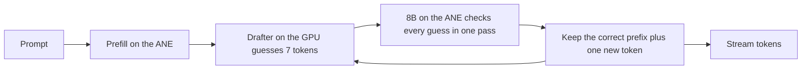

# Anemone

Low-energy LLM inference on the Apple Neural Engine (ANE), with exact output.

Anemone runs the large model on the ANE and a small drafter on the GPU. The drafter guesses the next 7 tokens, and the ANE checks all of them in one pass. Qwen3-8B generates **46 tokens/s on an M3 Pro at 0.49 J per token: 1.45x less energy than the fastest GPU decoder we measured (mlx-dspark, 62 tokens/s) and 2.5x less than plain MLX**. The output is token for token what the model produces on its own, and the GPU stays almost idle.

```text
$ anemone bench --model models/qwen3-8b-4k-tree
math      plain  16.1 tok/s   speculative  74.3 tok/s   accepted 5.53   lossless yes
code      plain  16.0 tok/s   speculative  69.3 tok/s   accepted 4.93   lossless yes
explain   plain  16.1 tok/s   speculative  44.7 tok/s   accepted 2.91   lossless yes
summary   plain  16.0 tok/s   speculative  33.9 tok/s   accepted 1.95   lossless yes
advice    plain  16.0 tok/s   speculative  36.5 tok/s   accepted 2.21   lossless yes
translate plain  15.9 tok/s   speculative  16.8 tok/s   accepted 0.56   lossless yes
mean      plain  16.0 tok/s   speculative  45.9 tok/s   accepted 3.01   lossless 6/6
```

## Results

Qwen3-8B, thinking off, greedy decoding, 6 prompts x 256 tokens. M3 Pro 18 GB, macOS 27.0.1, AC power, all rows measured the same night (2026-10-24).

| engine | where the 8B runs | tokens/s | system power | energy per token | output equal to plain greedy |
|---|---|---|---|---|---|
| **Anemone, tree drafter: 8B on the ANE, drafter on the GPU** | **ANE** | **45.9** | **20.8 W** | **0.49 J** | **6 of 6 prompts** |
| [mlx-dspark](https://github.com/ARahim3/mlx-dspark) 0.20.3, MLX 4-bit + the same DSpark drafter | GPU | 62.0 | 38.0 W | 0.71 J | 2 of 6 |
| MLX 4-bit (mlx-lm 0.32.2) | GPU | 30.4 | 33.8 W | 1.20 J | 6 of 6 |
| Anemone without the drafter | ANE | 16.2 | 17.4 W | 1.10 J | - |

- mlx-dspark is 1.35x faster. Anemone uses 1.45x less energy per token at 55% of the power, and its GPU draws about 1 W, so the GPU stays free for other work.
- mlx-dspark's answers drift from plain greedy decoding after 24 to 173 tokens on 4 of the 6 prompts (its batched check rounds differently). Anemone's match on every prompt.
- The Hugging Face folder still has the chain drafter: 44.0 tokens/s and 0.51 to 0.53 J per token. The tree drafter is in the next upload.

Qwen3-4B, same setup and night:

| engine | tokens/s | system power | energy per token | output equal to plain greedy |
|---|---|---|---|---|
| **Anemone** | **74.0** | **19.6 W** | **0.30 J** | **6 of 6** |
| mlx-dspark 0.20.3, same DSpark drafter | 94.5 | 33.5 W | 0.43 J | 2 of 6 |
| MLX 4-bit | 54.1 | 31.0 W | 0.64 J | 6 of 6 |

Qwen3-14B, same setup, 2026-10-25:

| engine | tokens/s | system power | energy per token | output equal to plain greedy |
|---|---|---|---|---|
| **Anemone** | **28.5** | **19.8 W** | **0.74 J** | **6 of 6** |
| mlx-dspark 0.20.3, the 14B DSpark drafter | 36.9 | 39.9 W | 1.17 J | 2 of 6 |
| MLX 4-bit | 16.8 | 32.7 W | 2.05 J | 6 of 6 |

- Tokens/s is decode speed (`anemone bench`, and mlx-dspark through [e15](docs/benchmarks.md#gpu-baselines) with its default settings). Power and energy are whole-system SMC readings over the generation window including prefill, two interleaved rounds each. See [Benchmarks](docs/benchmarks.md) for every run and its method.

The 4-bit weights are also closer to the original model than MLX 4-bit (KL against bf16, lower is better):

| 4-bit weights | KL, docs | KL, chat | top-1, docs | top-1, chat |
|---|---|---|---|---|
| **Anemone (GPTQ onto ANE lookup tables)** | **0.047** | **0.086** | **0.892** | **0.919** |
| MLX 4-bit affine, group 64 | 0.085 | 0.086 | 0.870 | 0.902 |
| Core AI default palettizer | 0.341 | 0.371 | 0.767 | 0.825 |

The docs set (four files from one code repo) shares a domain with the text these weights were calibrated on, so its 0.047 is optimistic. The converter's default calibration (Python standard library, five machine-learning library modules and the model's own chat answers, nothing from the docs repo) scores 0.059 on docs and 0.076 on chat in simulation, lower than MLX on both.

## How it compares

Other public work on LLMs and the Neural Engine, as each project reports it (October 2026). The chips and models differ, so read each row against its own baseline, not against the other rows.

| project | model, chip | where it runs | result against its GPU baseline |
|---|---|---|---|
| **Anemone** | **Qwen3-8B 4-bit, M3 Pro** | **8B on the ANE, DSpark drafter on the GPU** | **45.9 vs 62.0 tok/s for mlx-dspark, MLX 4-bit + the same drafter (0.74x), 1.45x less energy per token; 1.5x plain MLX 4-bit; output checked equal to plain greedy on every run** |
| [MacPaw research](https://research.macpaw.com/projects/neural-engine) | LFM2.5-2.6B 8-bit, M4 Pro | model on the ANE with a DSpark drafter, trees up to 64 tokens | 136.9 vs 144.9 tok/s for MLX 8-bit + DSpark (0.94x), 2.6x to 3.4x less energy per request; no code published |
| [ANEMLL Forge](https://github.com/Anemll/anemll-forge) | Qwen3.8-27B 3-bit, M6 (M5 or newer only) | model and DFlash2 drafter on the ANE | 60.8 vs 54.2 tok/s for llama.cpp 3-bit at 8K context (1.12x), 41% to 47% less energy per token, up to 192K context |
| [mlx-ane-sd](https://github.com/allbilly/mlx-ane-sd) | Qwen3-4B 6-bit, M4 Pro | model and DFlash drafter on the ANE | 64.8 vs 29.3 tok/s for MLX bf16 (2.21x); token-identical only in a 1.80x setup |
| [ANEMLL](https://github.com/Anemll/Anemll) | Qwen3-8B, M3 | model on the ANE, no drafter | 2.97 tok/s after the 1 MiB DMA fix ([audit](https://runaihome.com/blog/apple-neural-engine-llm-inference-2026/)) |

What is different about Anemone:

- **Energy per token.** 0.49 J for an 8B, against 0.71 J for the fastest GPU decoder with the same drafter and 1.20 J for plain MLX on the same Mac. Like MacPaw's ANE engine, Anemone trades some speed against the best GPU path for a large cut in energy.
- **The GPU stays free.** The drafter is the only GPU work (about 1 W). Anemone and mlx-dspark, both running an 8B at the same time on one 18 GB Mac, give 40 + 49 = about 88 tokens/s, against 63 for the fastest single engine (lab e17).
- **It runs on an M3 Pro with 18 GB.** The other drafter results in the table need an M4 Pro, or an M5 or newer.
- **Each engine does what it is good at.** The 8B runs on the ANE, which has spare compute to check 16 guesses at once. The drafter runs on the GPU, which streams weights about twice as fast as the ANE and so suits the drafter's small sequential steps. The two barely slow each other down when run at the same time (lab e14: 9 layers take 23.6 ms on the GPU and 15.4 ms on the ANE alone, 25.0 ms together).
- **The output is exact.** `anemone bench` compares every speculative answer token for token with plain greedy decoding of the same weights. mlx-dspark's answers drift from plain greedy on 4 of the 6 bench prompts.
- **Standard Core AI, no private APIs.** The GPTQ weights use Apple's own 4-bit lookup-table format, so they export through Core AI unchanged and run wherever Core AI runs.

Where others are ahead today:

- Speed: on this Mac mlx-dspark is 1.35x faster. Its 8-row GPU check takes 49 ms against 64 ms for the ANE, and its drafter 11.7 ms against our 21 ms. Our drafter takes 16 ms when the GPU is already busy; after each 64 ms ANE check the GPU starts cold ([Benchmarks](docs/benchmarks.md#drafter-cost)).
- Trees: MacPaw verifies trees of up to 64 tokens and keeps 5.6 tokens per cycle, against 4.0 for our width-16 trees.
- Context: Forge reaches 64K to 192K tokens. Anemone runs 16384 today; at 10.9K tokens it decodes 10.6 tokens/s. At 5423 tokens of context the GPU decodes faster (mlx-dspark 31.3 tokens/s, plain MLX 25.4, Anemone 17.9), though Anemone still prefills 13% faster and uses 2.3x less energy per request ([Benchmarks](docs/benchmarks.md#long-context-one-chunk-width-16)).
- Models: ANEMLL and Forge cover several families and sizes. Anemone runs three Qwen3 sizes (4B, 8B, 14B) and R1-0528-Qwen3-8B.
- Chips: every Anemone number is from one M3 Pro. On an M4 Max, MLX alone runs an 8B at about 90 tok/s ([apple-silicon-llm-bench](https://github.com/john-rocky/apple-silicon-llm-bench)); we have no numbers on M1, M2, M4 or M5 yet.

## Quick start

Requirements: an Apple Silicon Mac with macOS 27 and Xcode 27. Tested on M3 Pro (18 GB).

```sh
git clone https://github.com/vakharwalad23/Anemone.git
cd Anemone
swift build -c release
export ANEMONE_MODEL=vakharwalad23/Qwen3-8B-Anemone
.build/release/anemone run "Explain how a CPU cache works."
```

The first run downloads the model folder from [Hugging Face](https://huggingface.co/vakharwalad23/Qwen3-8B-Anemone) (6 GB) and compiles it for the ANE, about 12 minutes on an M3 Pro. macOS caches the result per app, so later runs start in a few seconds.

```sh
.build/release/anemone chat
.build/release/anemone bench
```

Or serve an OpenAI-compatible API and point any OpenAI client at `http://127.0.0.1:8080/v1`:

```sh
.build/release/anemone serve --port 8080
curl http://127.0.0.1:8080/v1/chat/completions -H "Content-Type: application/json" \
  -d '{"messages": [{"role": "user", "content": "Write a haiku about the sea."}], "stream": true}'
```

To build a model folder yourself, see [Converting a model](docs/convert.md); `--model` also takes a local folder.

## Use it from Swift

```swift
// Package.swift
.package(url: "https://github.com/vakharwalad23/Anemone.git", branch: "main")
```

```swift
import Anemone

let model = try await LanguageModel.load(from: ModelFolder.download("vakharwalad23/Qwen3-8B-Anemone"))
for try await event in model.generate([ChatMessage(.user, "Write a haiku about the sea.")]) {
    switch event {
    case .text(let piece): print(piece, terminator: "")
    case .finished(let response): print("\n\(response.stats.tokensPerSecond) tok/s")
    }
}
```

## How it works



- Decoding one token at a time is limited by how fast the weights stream from memory, and the ANE streams them at about half the GPU's speed. On its own the ANE loses: 16.2 tokens/s against 30.4 for MLX.
- The ANE has spare compute, so checking 16 tokens costs about the same as producing one: 64 ms per check against 62 ms per plain token.
- The DSpark drafter from DeepSeek is small and runs on the GPU in 21 ms. Its runner-up guesses fill the spare rows of the check as side branches. A cycle of draft plus check takes 86 ms and yields 4.0 tokens on average.
- A guess is kept only if it equals the 8B's own top choice, so the text is identical to plain greedy decoding. `anemone bench` checks this on every run.

Details: [Architecture](docs/architecture.md) and [Math](docs/math.md).

## What is new

- GPTQ onto the ANE lookup tables. Core AI stores 4-bit weights as 16 values per group of 32 rows. Anemone picks the 16 values with activation-weighted k-means, then snaps one input column at a time and pushes each column's rounding error onto the columns not yet snapped. The result still has 16 values per group, so it exports through Core AI unchanged: same size and speed as Apple's default, 7.3x lower KL.
- Calibration on the model's own chat answers. Adding the model's replies to 16 unrelated prompts lowered chat KL from 0.139 to 0.086.
- The drafter as one Core AI GPU program. It adds the 8B's hidden states to its context and drafts 7 tokens with a runner-up for each in one call, with fixed shapes so nothing recompiles.
- One KV cache for every context size. Each call uses the smallest context the conversation fits in, which is faster at short context.
- The MLP with the tokens on the width axis. Apple's iOS MLP puts the tokens on the convolution's batch axis, and for the 14B's larger weights the ANE then runs it once per token: a 14B layer took 16.8 ms at width 8 and 64.3 ms at width 32. With the tokens on the width axis, as Apple's attention has them, it takes 3.0 ms at both, and the 14B went from 2.9 to 28.5 tokens/s.
- Row-wise attention for long context. Apple's attention for the ANE transposes the scores so the context sits on the channel axis, and at 8192 that makes a chunk 2.1x slower than at 4096. One last-axis softmax per KV group gives the same result (within 6e-7) at 1.5x.

## Converting a model

```sh
uv run --project convert --extra export anemone-convert quantize --out work/qwen3-8b-lut4
uv run --project convert --extra export anemone-convert target --checkpoint work/qwen3-8b-lut4 --out work/qwen3-8b-chunks
uv run --project convert --extra export anemone-convert drafter --out work/drafter.aimodel
uv run --project convert anemone-convert package --chunks work/qwen3-8b-chunks --drafter work/drafter.aimodel --out models/qwen3-8b
```

See [Converting a model](docs/convert.md) for what each step does, how long it takes and how much memory it needs.

## Status and roadmap

Working today: Qwen3-4B, Qwen3-8B and Qwen3-14B (thinking off) and DeepSeek-R1-0528-Qwen3-8B (it always thinks, and the Qwen3-8B drafter accepts about half as much on its text: 29.8 tokens/s), greedy decoding, up to 16384 tokens of context, one request at a time, `run`, `chat`, `serve` (OpenAI-compatible, streaming) and `bench`.

Done:

- Drafter runtime picked by measurement, Swift engine and CLI, converter, 4096-token context, OpenAI-compatible server.
- Qwen3-8B published on [Hugging Face](https://huggingface.co/vakharwalad23/Qwen3-8B-Anemone).
- Qwen3-4B through the same converter with no code changes: 74.0 tokens/s, lossless, KL against bf16 0.077 (docs) and 0.112 (chat) vs 0.095 and 0.107 for MLX 4-bit.
- Tree verify: side branches from the drafter's runner-up tokens fill the spare rows of each check, 4% faster than chains (45.9 vs 44.0 tokens/s).
- Converter calibration that does not favor one domain (docs KL 0.107 -> 0.059).
- Independent GPU baseline (mlx-dspark) and energy of the 4096-context folder, measured the same night.
- 8192-token context: the cliff at 8192 was Apple's attention transposing the scores; row-wise attention brings a chunk from 46.4 to 31.0 ms, and a 5449-token prompt decodes at 22.7 tokens/s, lossless.
- 16384-token context: a 10923-token prompt decodes at 10.6 tokens/s (6.2 plain), lossless.
- Qwen3-14B: 28.5 tokens/s at 0.74 J per token, lossless, after moving the MLP's tokens off the batch axis (it ran at 2.9 before). KL against bf16: docs 0.051, chat 0.068 (MLX 4-bit 0.074 and 0.058).

Coming, in this order:

1. Qwen3-4B, Qwen3-14B and the updated Qwen3-8B on Hugging Face (uploading).
2. A faster draft: the drafter call takes 16 ms on a busy GPU but 21 ms after each ANE check.
3. Longer context: 32K, and a faster prefill and decode for long prompts (at 10.9K tokens a check reads the whole KV cache).
4. Fewer bytes per check. Core AI's palettizer offers 1, 2, 4 and 6 bits, not 3; whether 2-bit tables on a few layers keep the quality is untested.
5. Other chips: numbers from M1, M2, M4 and M5 Macs. See [Contributing](CONTRIBUTING.md).

## Docs

- [Architecture](docs/architecture.md): parts, decode loop, model pipeline.
- [Math](docs/math.md): the formulas behind speed, energy and quality, with worked examples.
- [Benchmarks](docs/benchmarks.md): every measurement, with setup and method.
- [Usage](docs/usage.md): commands, the server API, the Swift API.
- [Converting a model](docs/convert.md).
- [Contributing](CONTRIBUTING.md): measurements from other Macs are the most useful contribution.

## Credits

- DeepSeek's DeepInfer for the DSpark drafter and confidence-scheduled verification.
- Apple's Core AI and coreai-models for the ANE runtime and export tools.
- Qwen3 by the Qwen team. Model weights keep their own licenses.

## License

MIT. See [LICENSE](LICENSE).
