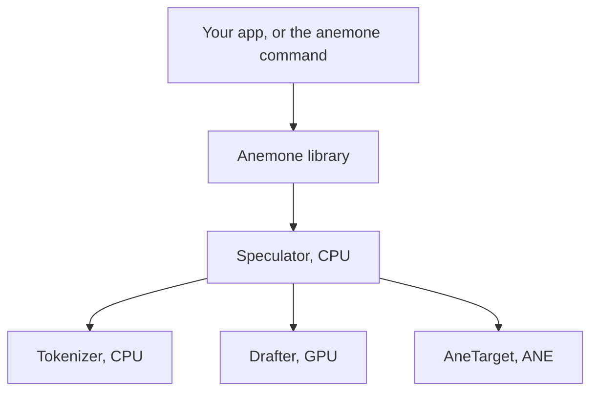
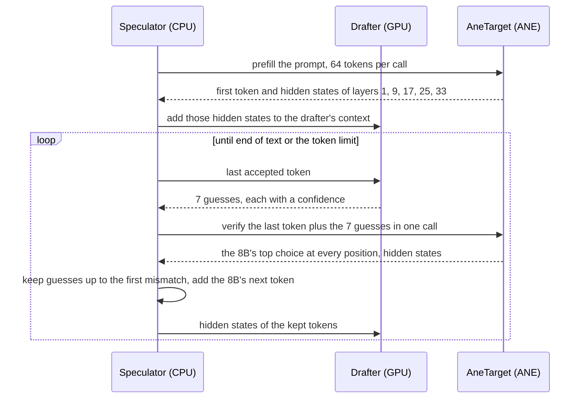
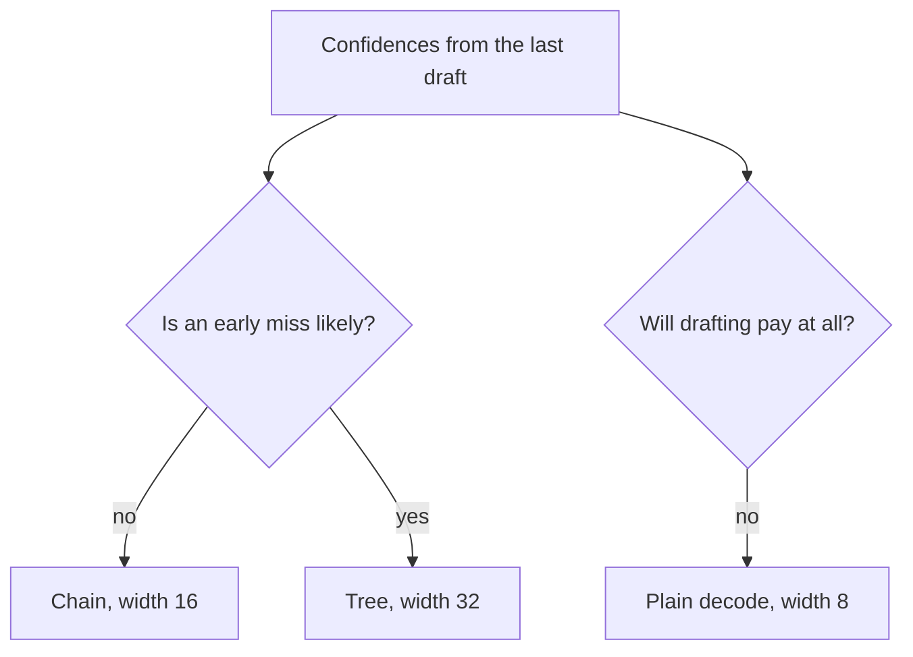

# Architecture

Timings are from the Swift engine (`anemone bench`) and the lab prototype it was built from, on an M3 Pro, macOS 27.0.1, AC power. Trees and confidence scheduling are not built yet.

## Parts

| part | runs on | job |
|---|---|---|
| `Anemone` library | CPU | public Swift API for apps: load a model folder, stream tokens for a prompt |
| `anemone` command | CPU | `run` (one prompt), `chat` (REPL), `serve` (OpenAI-compatible HTTP on localhost); a thin client of the library |
| `Speculator` | CPU | the decode loop: draft, verify, accept, feed the drafter, stream |
| `AneTarget` | ANE | the large model, split into four Core AI programs of 9 layers each |
| `Drafter` | GPU | the DSpark drafter: 5 layers that guess the next 7 tokens |
| `Tokenizer` | CPU | Hugging Face tokenizer and chat template |

## Decode loop

- One cycle costs 20.6 ms of drafting and 62.3 ms of verifying in the Swift engine (`anemone bench` mean), plus about 0.1 ms on the CPU.
- A guess is kept only if it equals the 8B's top choice at that position, so the output is identical to plain greedy decoding. `anemone bench` checks this token for token on every prompt.
- The token after the last kept guess comes free from the same verify call, so each cycle yields at least one token.

## The large model on the ANE

- Qwen3-8B has 36 layers. It is split into four chunks of 9 layers. The last chunk also holds the final norm, the 151936-wide output layer and the argmax, so only token ids and hidden states leave the ANE.
- Weights are 4-bit lookup tables: 16 values per group of 32 output rows. Chunks are 880 MB each, 1.2 GB for the last.
- Each chunk has one function per (context rung, call width) pair: widths 8, 16, 32 and 64, rungs from 256 doubling up to the export's context (1024 or 4096). All rungs share one KV buffer laid out for the largest; a smaller rung binds a prefix view of it, and each call uses the smallest rung that holds it.
- The attention mask and the positions are inputs. Chains, token trees and replays all run on the same functions without a new export.
- The KV cache stays on the ANE. A write must start at a position that is a multiple of 4, so a call replays up to 3 earlier tokens. Last token, 7 guesses and up to 3 replays fit in width 16.
- The four chunks are chained with Core AI `encode`, which the Swift timing tool measured at the same cost as `run`. No CPU round trip between chunks.

## The drafter

- DSpark block 7 from DeepSeek: 5 transformer layers that read the 8B's hidden states at layers 1, 9, 17, 25 and 33.
- A markov head adds a low-rank next-token correction to each guess. A confidence head estimates the chance each guess is accepted.
- It runs as one Core AI program on the GPU. Each call adds the hidden states of the newly accepted tokens to its context, drafts the 7 guesses, and writes the 16-row input of the next ANE verify, so the guesses go from GPU to ANE without passing through the CPU.
- All shapes are fixed: positions, counts and offsets are inputs, and attention reads the whole cache through a mask. Changing shapes made Core AI recompile on every call (about 350 ms each).
- Chained with `encode`, draft plus verify takes 83.7 ms per cycle, against 87.4 ms when each call waits for the last. MLX was measured as the alternative: same acceptance, no faster cycle, and a second runtime to ship. See [Benchmarks](benchmarks.md#drafter-runtime).

## Trees and confidence scheduling (planned)

A width-16 call has room for more than one chain of guesses. The free slots hold second-choice branches, placed where they are most likely to pay off (formula in [Math](math.md#token-trees)).

Measured in the lab: width-32 trees accept 20% more tokens (3.29 vs 2.74 per cycle) but cost 11% more verify time and 6 ms more drafting, so in Python they break even. They pay once branch drafting is batched.

## Model pipeline

```mermaid
flowchart LR
    HF["bf16 checkpoint"] --> CAL["Calibration text: docs, code, the model's own chat answers"]
    CAL --> H["Input statistics per linear layer"]
    H --> Q["k-means lookup tables, then GPTQ snapping"]
    Q --> X["Core AI export, four ANE chunks"]
    X --> M["Model folder: chunks, drafter, tokenizer, config"]
    M --> HUB["Hugging Face Hub"]
    HUB --> L["First load on a Mac: about 7 min of ANE compilation"]
    L --> R["Later loads: instant"]
```

- Palettizing the 8B takes about 30 min on the CPU. Export takes 99 to 167 s per chunk with a peak of 9.2 GB of RAM.
- The first load on a Mac compiles each chunk for the ANE: 98 to 116 s per chunk. The compiled result is cached across processes of the same binary, so a second process loads in 0.0 s.

## Correctness checks

- Lossless: speculative output equals plain greedy output on the ANE, token for token.
- Quality: KL and top-1 agreement against the bf16 model on docs and chat text, published with each model. A model ships only if both are at or better than MLX 4-bit.
- Determinism: the same prompt gives the same output on every run.

## Limits today

- Greedy decoding only, one request at a time.
- Context: 1024 tokens with the default export, 4096 with `target --context 4096`. At 8192 a chunk costs 3.1x more than at 1024, for a reason not yet found.
- macOS 27 only. Tested on M3 Pro only.
