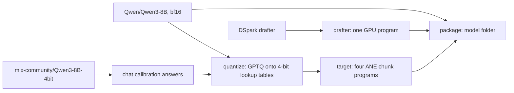

# Converting a model

The converter turns a Hugging Face checkpoint into an Anemone model folder. It is a Python project in `convert/` that runs through [uv](https://docs.astral.sh/uv/). Supported today: Qwen3-8B with the `deepseek-ai/dspark_qwen3_8b_block7` drafter.



## Steps

Run from the repo root. Timings are from an M3 Pro, 18 GB, macOS 27.0.1.

```sh
uv run --project convert --extra export anemone-convert quantize --out work/qwen3-8b-lut4
uv run --project convert --extra export anemone-convert target --checkpoint work/qwen3-8b-lut4 --out work/qwen3-8b-chunks
uv run --project convert --extra export anemone-convert drafter --out work/drafter.aimodel
uv run --project convert anemone-convert package --chunks work/qwen3-8b-chunks --drafter work/drafter.aimodel --out models/qwen3-8b
```

| step | what it does | time | peak memory |
|---|---|---|---|
| `quantize` | Runs the bf16 model one layer at a time over calibration text, then replaces every linear layer with 4-bit lookup-table weights chosen by GPTQ | not measured yet in the converter (GPTQ alone took about 30 min in the lab) | not measured |
| `target` | Exports the quantized checkpoint as four 9-layer Core AI programs with call widths 8, 16, 32, 64 and context rungs from 256 up to `--context` | 354 s for the four chunks | 11.7 GB |
| `drafter` | Exports the DSpark drafter as one static-shape int4 GPU program with two entry points: `main` (draft) and `inject` (prompt) | about 2 min (134 s in the lab) | not measured |
| `package` | Links the programs into a folder, writes the fp16 embedding table, the tokenizer files and `anemone.json` | seconds | small |

- `quantize` calibrates on six Python standard library files (prose, docs and code) and on the model's own answers to 16 chat prompts. It writes those answers with the MLX copy of the model, so the first run downloads `mlx-community/Qwen3-8B-4bit` (4.6 GB). Pass `--chat-calibration answers.json` to reuse a saved set.
- `target --context 4096` adds the 2048 and 4096 rungs. Short conversations still use the small rungs, so the verify costs the same at short context (62.3 ms); the 4096 drafter attends over more slots and drafts in 24 ms instead of 21. First load of a 4096 folder: 702 s.
- `drafter --context` must match the target's largest rung.
- Downloads: the bf16 checkpoint is 16.4 GB. `package` hard-links the programs, so the folder costs only the 1.2 GB embedding table on top of the work directory.

## The model folder

| file | contents |
|---|---|
| `anemone.json` | chunk file names, drafter, embedding table, hidden size, vocabulary size, end-of-text ids |
| `chunk-00-09.aimodel` ... `chunk-27-36.aimodel` | the target on the ANE, 0.84 GB each, 1.1 GB for the last with the head |
| `drafter.aimodel` | the drafter on the GPU, 1.3 GB |
| `embeddings.f16` | the target's token embeddings, fp16, row major |
| `tokenizer.json`, `tokenizer_config.json`, ... | tokenizer and chat template |

## Checking a conversion

```sh
.build/release/anemone bench --model models/qwen3-8b
```

Every row must say `lossless yes`. On an M3 Pro the mean is about 45 tokens/s speculative and 16 tokens/s plain.
