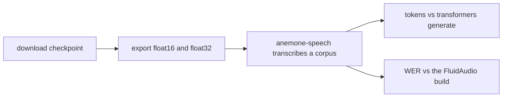

# Speech research: Orukeet on the Neural Engine

How fast Orukeet (Oruk AI's 0.6B ASR, a fine-tune of NVIDIA Parakeet-TDT 0.6B v3, https://huggingface.co/oruk/orukeet) runs on the ANE through Core AI, at the accuracy of the FluidAudio Core ML build. Experimental branch; nothing here is part of the Anemone SDK.

Status: S0 (export and parity) done; S1 (placement and timing) next.

| Step | Result | Report |
|---|---|---|
| S0 export and parity | Core AI FP16 ties or beats TapTalk's 6-bit Core ML build on clips up to 15 s: FLEURS en_us 3.53% vs 3.83%, LibriSpeech test-clean 1.51% vs 1.53%; FP32 tokens identical to transformers on 100 / 100 clips | `reports/s0-parity.md` |

M3 Pro, 18 GB, macOS 27.0.1 (26A434), AC power.

## What it needs

- macOS 27 and Xcode 27 (Core AI), uv, the `hf` CLI.
- 2.5 GB for the Orukeet checkpoint (`model.safetensors` sha256 `092cff73445117d4d234c5e4fb37d86ad16a348be3426e10ff38c79d35758569`) and 3.4 GB for the FP16 and FP32 bundles (1.1 + 2.3 GB) under `work/speech/` (ignored by git). Exports take 15 to 35 s and peak at 5.5 GB of memory (S0).
- No converted Orukeet bundle is published. Orukeet's weights are CC-BY-SA-4.0; export your own with the commands below.

## S0: export and parity



```sh
make -f speech/Makefile env download build
make -f speech/Makefile export DTYPE=float16
make -f speech/Makefile export DTYPE=float32
make -f speech/Makefile transcribe BUNDLE=work/speech/exports/orukeet_float16_static MANIFEST=<corpus>/manifest.json AUDIO=<corpus wavs> OUT=work/speech/hyps/<corpus>/orukeet-coreai-w188-fp16.json
make -f speech/Makefile parity MANIFEST=<corpus>/manifest.json AUDIO=<corpus wavs> HYPS=work/speech/hyps/<corpus>/orukeet-coreai-w188-fp16.json
```

`build` resolves `apple/coreai-models` at `9e12065`; `export` uses that checkout's `models/parakeet/export.py`, so the Python exporter and the Swift runtime come from one commit.

How this differs from Apple's Parakeet recipe:

- `speech/convert/export_orukeet.py` calls the exporter's `create_parakeet` directly. The exporter's CLI accepts only `nvidia/parakeet-tdt-0.6b-v3`, and it writes NVIDIA's author and CC-BY-4.0 license into every asset; the wrapper writes Orukeet's (CC-BY-SA-4.0).
- The wrapper first checks that the checkpoint loads with no missing, unexpected or mismatched keys under the exporter's `transformers>=5.9.0,<5.10.1` pin. Orukeet's `config.json` was written by transformers 5.15.1.
- The env takes `librosa` instead of `transformers[audio]`: the Parakeet feature extractor needs only librosa, and the extra also pulls `kenlm`, which builds from source.
- The window is 15.0 s, not the 15.04 s in Apple's examples. 15.0 s is 240000 samples, 1501 mel frames and 188 encoder frames, the same shape as the FluidAudio encoder; 15.04 s gives 189.

```math
F_{enc} = \left\lceil \frac{F_{mel}}{8} \right\rceil, \quad F_{mel} = 1 + \left\lfloor \frac{S}{160} \right\rfloor
```

`S` is the window in samples at 16 kHz, `160` the mel hop, `8` the encoder subsampling. Worked example: S = 240000 gives F_mel = 1501 and F_enc = ceil(187.6) = 188; S = 240640 (15.04 s) gives 1505 and 189.

## What does not work yet

- A static bundle truncates audio longer than its window without an error. S0 scores clips up to 15.0 s against the FluidAudio build on the same clips; full-set scores need the chunking planned for S5.
- The FP32 bundle cannot run on the ANE (no FP32 there); it is an accuracy reference only.
- `ms` in S0 hypotheses includes the stage capture used for token parity, so it is not a speed number. Timing starts in S1.
