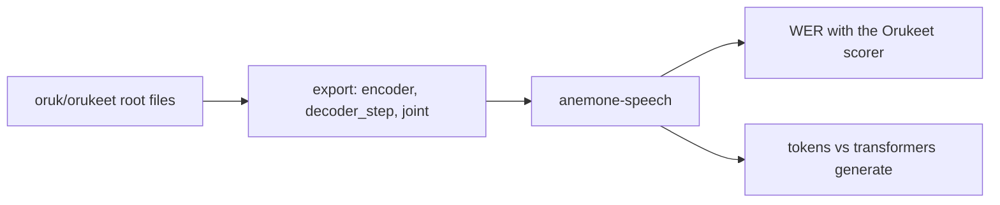

# S0: Orukeet through Core AI, accuracy parity

Orukeet r3 (`oruk/orukeet` at `b59c13a`) exported to Core AI with Apple's Parakeet exporter, as one static 15.0 s window, transcribes as accurately as TapTalk's 6-bit Core ML build on every clip that fits the window. On FLEURS en_us it is more accurate. The FP32 bundle reproduces the Transformers reference decode token for token.

All numbers: Apple M3 Pro, 18 GB, macOS 27.0.1 (26A434), AC power, 2026-10-27 and 2026-10-28.

## Result

Clips up to 15.0 s (the window). Baseline: TapTalk's installed Orukeet Core ML build (6-bit LUT, FluidAudio 0.17.5), hypotheses from the 2026-10-14 run on the same macOS build.

| Set (clips, words) | TapTalk 6-bit Core ML | **Core AI FP16** | Core AI FP32 | 6-bit minus FP16, 95% CI |
|---|---|---|---|---|
| FLEURS en_us test (595, 12652) | 3.83% (485 errors) | **3.53% (447)** | 3.52% (445) | [+0.10, +0.50] pp |
| LibriSpeech test-clean (2382, 41067) | 1.53% (630) | **1.51% (622)** | 1.52% (625) | [-0.03, +0.07] pp |

```math
\mathrm{WER} = \frac{S + D + I}{N}
```

`S`, `D`, `I`: substituted, deleted and inserted words after normalization; `N`: reference words. Worked example, FLEURS, Core AI FP16: 447 / 12652 = 3.53%. The interval is a paired bootstrap over speakers (10,000 resamples); FLEURS has no speaker ids, so it resamples clips. An interval that excludes 0 is a real difference: on FLEURS the 6-bit build makes more errors, on LibriSpeech the two tie.

Token parity against `transformers` 5.9.0 `ParakeetForTDT.generate` (FP32, CPU) on the first 50 clips up to 15 s of each set:

| Bundle | FLEURS | LibriSpeech | Total |
|---|---|---|---|
| FP32 | 50 / 50 identical | 50 / 50 | **100 / 100** |
| FP16 | 49 / 50 (one clip differs from its 6th token on) | 50 / 50 | 99 / 100 |

## Method



- Weights: `model.safetensors` sha256 `092cff73445117d4d234c5e4fb37d86ad16a348be3426e10ff38c79d35758569` (2,508,311,120 bytes, matches the Hub's LFS record). The checkpoint loads into `ParakeetForTDT` with no missing, unexpected or mismatched keys under the exporter's `transformers>=5.9.0,<5.10.1` pin (723 tensors), although Orukeet's `config.json` was written by 5.15.1.
- Export: `speech/convert/export_orukeet.py` drives `apple/coreai-models` `models/parakeet/export.py` at `9e12065` (coreai-torch 0.4.3, torch 2.9.0), static 240000 samples = 1501 mel frames = 188 encoder frames, the FluidAudio encoder's shape. FP16 took 33 s (peak 4.9 GB), FP32 14 s (peak 5.5 GB); bundles are 1.1 GB and 2.3 GB.
- Runtime: Apple's `CoreAISpeech` (same commit) through `anemone-speech` (`make transcribe`), greedy TDT, each graph on Core AI's default compute unit.
- Scoring: Orukeet's English scorer (`Oruk-AI/orukeet` `evaluation/standard_asr` at `24dedf1`), the same normalizer for every model. Sets: FLEURS en_us test (CC-BY-4.0) and LibriSpeech test-clean (CC-BY-4.0), full splits, sealed by hash.

## What does not work yet

- Clips longer than the window are cut off without an error. On the full sets that costs FP16 5.03% vs 4.23% on FLEURS (262 deletions vs 85) and 6.29% vs 1.51% on LibriSpeech (2611 deletions vs 61); 52 of 647 and 238 of 2620 clips are longer than 15.0 s. TapTalk's runtime chunks long audio. Chunking here is planned with the long-file step (S5).
- No speed number yet. The S0 tool captured every stage for the parity check and left placement to Core AI; its 113 ms median per FLEURS clip (FP16) is not comparable with TapTalk's 50.8 ms. Placement and timing are the next step (S1).
- swift-transformers does not know `ParakeetTokenizer` and falls back to a plain BPE decoder. The scores above use that text; case can differ from TapTalk's ("west" vs "West"), which the normalizer ignores.

## Reproduce

From the repo root, on branch `experiments/speech-research`, with a local copy of the two sets (16 kHz wav files and a manifest listing `id`, `wav`, `seconds`):

```sh
make -f speech/Makefile env download build
make -f speech/Makefile export DTYPE=float16
make -f speech/Makefile transcribe BUNDLE=work/speech/exports/orukeet_float16_static MANIFEST=<set>/manifest.json AUDIO=<set wavs> OUT=work/speech/hyps/<set>/orukeet-coreai-w188-fp16.json
make -f speech/Makefile parity MANIFEST=<set>/manifest.json AUDIO=<set wavs> HYPS=work/speech/hyps/<set>/orukeet-coreai-w188-fp16.json
```
