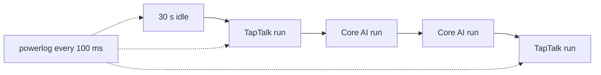

# S7: energy per second of audio

Transcribing FLEURS and LibriSpeech with Orukeet through Core AI (int8 encoder windows on the ANE, decoder on the CPU) uses 20% and 32% less energy per second of audio than TapTalk's 6-bit Core ML build, on clips up to 15 s. Both draw about 16 W of system power while they run and leave the GPU idle; the saving is the shorter run.

All numbers: Apple M3 Pro, 18 GB, macOS 27.0.1 (26A434), AC power, 2026-10-28, one session.

## Result

Clips up to 15.0 s, A B B A full-set runs per set, mean of each model's two runs:

| Set (audio) | TapTalk 6-bit Core ML | **Core AI int8 windows** | Ratio |
|---|---|---|---|
| FLEURS en_us test (5443 s) | 0.0786 J | **0.0628 J** | 0.80 |
| LibriSpeech test-clean (14774 s) | 0.1047 J | **0.0712 J** | 0.68 |

Joules per second of audio above idle. With idle included (`P_idle` = 0) the ratios are the same: 0.0895 vs 0.0716 J and 0.1191 vs 0.0811 J.

| Run | Mean system power | Mean GPU power |
|---|---|---|
| TapTalk, FLEURS / LibriSpeech | 15.98 / 16.19 W | 0.01 / 0.01 W |
| Core AI int8, FLEURS / LibriSpeech | 15.90 / 16.12 W | 0.09 / 0.10 W |
| Idle, 30 s before the runs | 1.96 W | - |

## Method



`powerlog` (Anemone lab tool) reads whole-system power from the SMC (`PSTR`) and GPU power from IOReport every 100 ms, without root. Without root there is no ANE-only counter, so the ANE's share is inside the system number.

```math
E_a = \frac{(\bar{P}_{sys} - P_{idle})\, t}{A}
```

`E_a`: joules per second of audio above idle; `P_sys`: mean system power over a run; `P_idle`: mean over the 30 s idle before the runs; `t`: the run's summed per-clip compute time on clips up to 15 s (model load and file reads excluded); `A`: their audio seconds. Worked example, LibriSpeech, Core AI: (16.12 - 1.96) W x 74.3 s / 14774 s = 0.0712 J per audio second.

Over the full sets, timed by wall clock, the ratios are 0.77 (FLEURS) and 0.66 (LibriSpeech), but that is not a fair comparison: TapTalk transcribes clips over 15 s in full and the Core AI window cuts them.

## What does not work yet

- One session, two runs per model per set; each pair agreed within 0.3% on compute time. Power was not repeated on another day.
- Batch transcription only. Live typing (S6) and long files (S5) are not measured.
- Whole-system power includes the display and background processes, the same for both models, and removed by the idle term.
